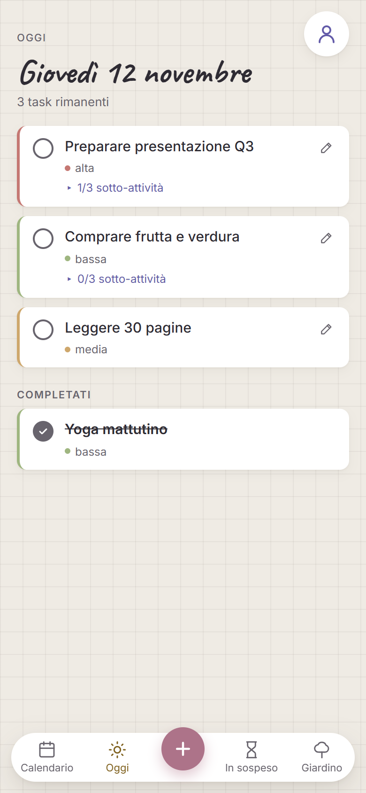
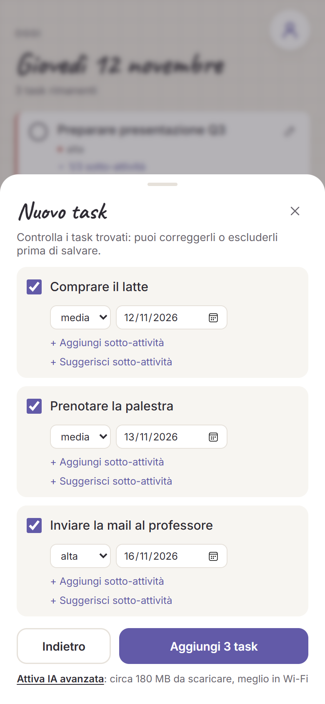
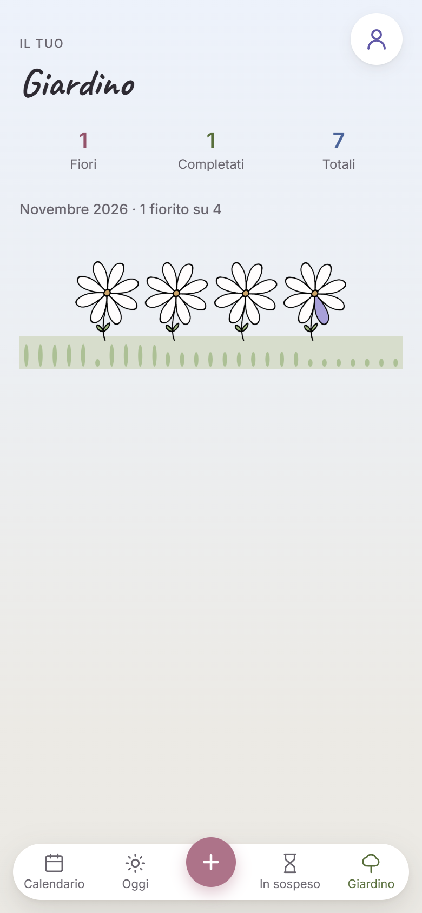

# FocusFlow

A task manager where every day grows a flower: one coloured petal for each task you complete. You type your plans in plain Italian ("comprare il latte oggi; prenotare la palestra domani; inviare la mail al professore lunedì, importante") and the app turns them into separate tasks with dates and priorities. An optional language model runs on your own device.

Live demo: https://focusflow-tj9t.onrender.com (free hosting, so the first load can take about a minute while the server wakes up). An Android build can be downloaded from the login page.

The interface is in Italian.

| Today | New task | Garden |
| --- | --- | --- |
|  |  |  |

*Screenshots from demo mode, with the sample data the app creates in the browser.*

## Why it exists

I built FocusFlow as the third test application for my internship research at the University of Perugia, which compares ways of converting a web app into an Android app (WebView, PWA, Cordova). It was designed to include features that make conversion hard, such as local notifications, heavy assets and, above all, an AI model that runs inside the page.

On the test phone (Samsung Galaxy A23, 4 GB RAM) the model ran only on WebAssembly, as the GPU path crashed the page. Answers took between 20 seconds and two minutes, and the low-memory killer sometimes closed the app. In practice the rules give the result and the model is an experiment, which is what the research needed to measure.

## Features

- **Today, Calendar and Overdue pages.** Tasks have a date, a priority and optional subtasks. Overdue tasks are grouped by priority and can be moved to a new date; every move is recorded.
- **Garden.** Each day gets one flower with up to 8 petals, one per completed task. A day with planned tasks and none completed gets a white flower. The flower is computed on the server, and past days are locked (HTTP 409), so the garden can't be edited after the fact.
- **Natural-language input.** The rules split the text into tasks at punctuation (`;`, `.`), read dates with chrono-node plus Italian fallback rules ("oggi", "domani", "lunedì") and set the priority from words like "urgente" or "importante". Two tasks joined by "e" in one sentence are not split yet.
- **On-device AI (optional).** "Attiva IA avanzata" downloads SmolLM2-135M-Instruct (about 180 MB, 4-bit ONNX) through Transformers.js. It runs on WebAssembly in a Web Worker, so the interface never freezes, and stays in the browser cache. Each step has a time limit (3 s to split text, 5 s for subtasks); if the model is slower, the rule-based result is used instead.
- **Accounts.** Registration, login, password change and account deletion. Passwords are hashed with bcrypt and sessions use JWT.
- **Demo mode.** If the server can't be reached, the frontend falls back to sample data stored in the browser.
- **Android app.** Built with Cordova from the same `public/` folder, plus a morning reminder through local notifications.

## Architecture

```
public/   HTML, CSS and ES-module JavaScript, no framework or build step
          js/nlp.js + js/nlp-worker.js: rules and the in-browser model
server/   Node.js + Express 5 REST API
          routes/: auth, tasks, subtasks, flowers, telemetry
          database/: MySQL schema and admin scripts
test/     unit tests (node:test) and integration tests against a running server
```

Backend details:

- Six MySQL tables: users, tasks, subtasks, flowers, task reschedules and telemetry.
- All input is validated on the server, with a cap of 8 tasks per day.
- Failed logins are rate-limited per IP and per IP+username, and registrations and password confirmations have their own limits.
- Technical measurements for the research (model load time, response times) are stored per user in a telemetry table, deleted after 90 days and removed together with the account.
- In production it runs on Render, with MySQL on Aiven over TLS. Deployment is described in `render.yaml`.

## Running it locally

Requirements: Node.js 20+, and MySQL 8 or MariaDB 10.5+.

```sql
CREATE DATABASE focusflow CHARACTER SET utf8mb4;
CREATE USER 'focusflow'@'localhost' IDENTIFIED BY 'choose-a-password';
GRANT ALL ON focusflow.* TO 'focusflow'@'localhost';
```

```bash
npm install
cp .env.example .env      # then set DB_PASSWORD and JWT_SECRET (32+ random characters)
npm run db:init
npm start                 # http://localhost:3000
```

Other scripts:

| Command | What it does |
| --- | --- |
| `npm run user:create -- name password` | Create a user from the terminal (useful with `ALLOW_REGISTER=false`) |
| `npm run user:password -- name` | Reset a password (typed at the prompt) |
| `npm test` | Unit tests for the text parser and server validation, no database needed |
| `npm run test:api` | API integration tests, needs the server and MySQL running |
| `npm run test:security` | Rate-limit and access-control tests, run against a freshly started server |

To try the frontend alone in demo mode, serve the `public/` folder with any static server, e.g. `python -m http.server 8080`.

## Notes

- Serve it over HTTPS when it is public: the access token travels in the `Authorization` header.
- Behind a proxy, set `TRUST_PROXY` so that rate limits see the real client IP.
- Rate-limit counters are kept in memory: they reset on restart and only cover one server instance.
- The flower and cat drawings are in `public/assets/`.
